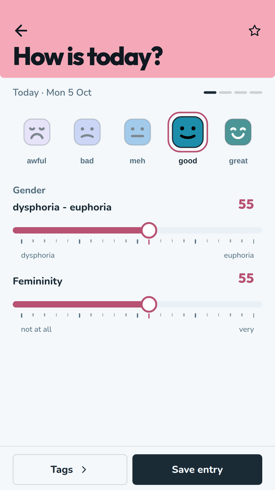
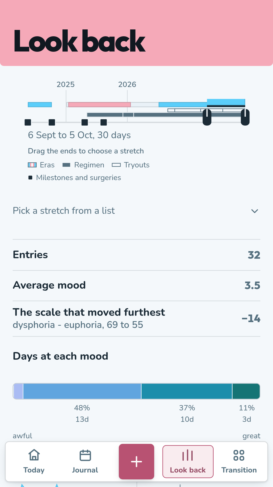
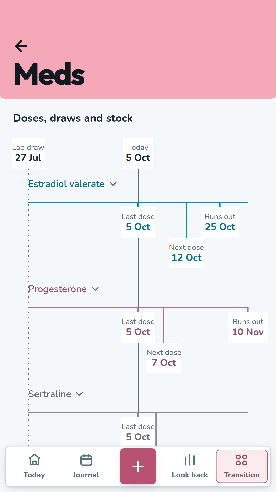

<h1>
  <picture>
    <source media="(prefers-color-scheme: dark)" srcset="brand/mark/png/lockup-dark.png">
    
  </picture>
</h1>

engender is a private journal for exploring your gender or keeping a record of
your transition. A trans person built it for other trans people. It keeps
everything on your device, and the Android app doesn't even ask for internet
access.

You might jot down how it felt when a barista called out your new name, mark
the day on a scale you named, then come back a month later to see how the
weeks moved.

**[Open the web app](https://journal.engender.app/)** · [Read the getting-started guide](https://engender.app/en/guide/)

The journal is free, works in English and Polish, and needs no account. You
can install the web app from your browser and use it offline after the first
load. The Android app is on the
[releases page](https://github.com/engender-app/engender/releases).

<p>
  
  
  
</p>

## What you can keep

- **Daily entries.** A mood is enough. Add a note, photo, voice recording or
  video note when you have more to say. Give each gender scale its own name
  and endpoints.
- **Things you try.** Save voice practice to compare later, put two photos
  side by side, log a presentation tryout or mark a milestone on your
  timeline.
- **Care records.** Log doses, lab results, appointments and surgeries, see
  when a supply runs out, and choose what goes into a summary for a
  clinician.
- **Looking back.** Find an entry by tag, search or the calendar. In Look back,
  drag the ends of your timeline to pick a stretch of time and see how your
  scales changed over it. You
  can also turn entries into a printable journal book.

You pick which of these areas appear, and you can bring in your history from
Daylio.

## Privacy and backups

**On Android, the operating system enforces the privacy.** Without the
`INTERNET` permission, engender can't open a network connection of its own,
even in the background. You can check that in the
[app's manifest](android/app/src/main/AndroidManifest.xml). When you share a
file, you pick the app that receives it, and that app has its own internet
access.

**On the web,** your browser contacts the host to load engender and check for
updates. The host keeps hourly totals of page openings, with no record of
individual visits. Your entries and photos stay in your browser's storage for
the site.

Both versions encrypt your journal and media on your device. You can lock the
journal and turn on disguise mode, which gives the app a neutral name and icon
everywhere outside the unlocked journal. Read the
[privacy policy](PRIVACY.md) ([po polsku](PRIVACY.pl.md)).

> [!WARNING]
> **Export an encrypted Archive before you clear app data or move devices.**
> Keep a copy somewhere other than the device, and keep its backup password.
> Nobody, including the maintainer, can recover a lost password or key. A
> recovery key can unlock a journal still on your device, but it can't bring
> back a deleted one.

Restore the Archive to open your journal on another device. On Android you can
also schedule encrypted backups to a folder. CSV files, journal books and
clinician summaries are not encrypted: anyone you share them with can read
them.

## Run from source

You need Node.js 24 and npm. From the repository root:

```sh
npm ci
npm run dev
```

Open the local URL Vite prints. The development server adds a demo bar with a
sample journal, theme controls and a phone-frame view, so you can try every
screen with invented data.

Once per clone, let git merge the message catalogues by key, so two branches
that add neighbouring strings don't conflict:

```sh
git config merge.catalogue.driver "node scripts/merge-catalogue.mjs %O %A %B %P"
```

Build before running the type checker or tests, because the build generates
files they read:

```sh
npm run build
npm run check
npm test
```

To build a debug APK, install JDK 21 and the Android SDK, set `ANDROID_HOME`
to the SDK directory, and copy the web build into the Android project first:

```sh
npm run build
npx cap sync android
cd android && ./gradlew assembleDebug
```

Where to go next:

- To find where a change belongs, read the [architecture guide](ARCHITECTURE.md).
- To run the browser, walkthrough and Android suites, see [Running tests](tests/README.md).
- To get a change merged, follow [Contributing](CONTRIBUTING.md).
- To host the web app on your own domain, follow the [self-hosting guide](deploy/SELF-HOSTING.md).
- To publish a release, see [Integrating a change](CONTRIBUTING.md#integrating-a-change).

## Help and licence

When you report a bug, use invented entries, never your real journal.
[Get support](SUPPORT.md) · [Report a security issue privately](SECURITY.md)

engender is licensed under [GPL-3.0-only](LICENSE).
