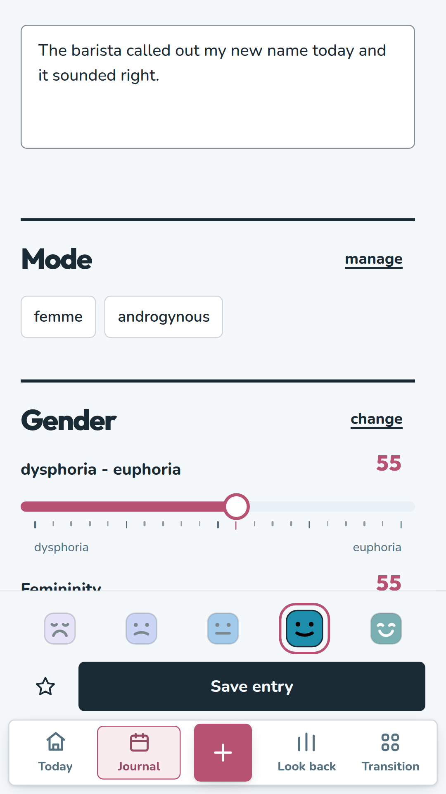
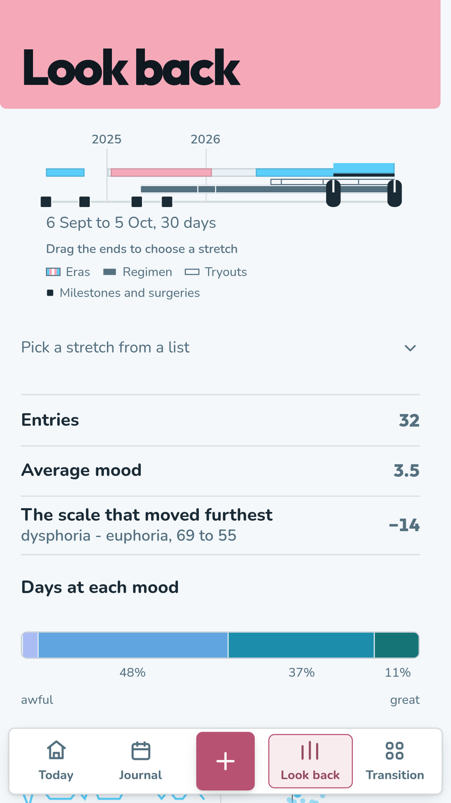
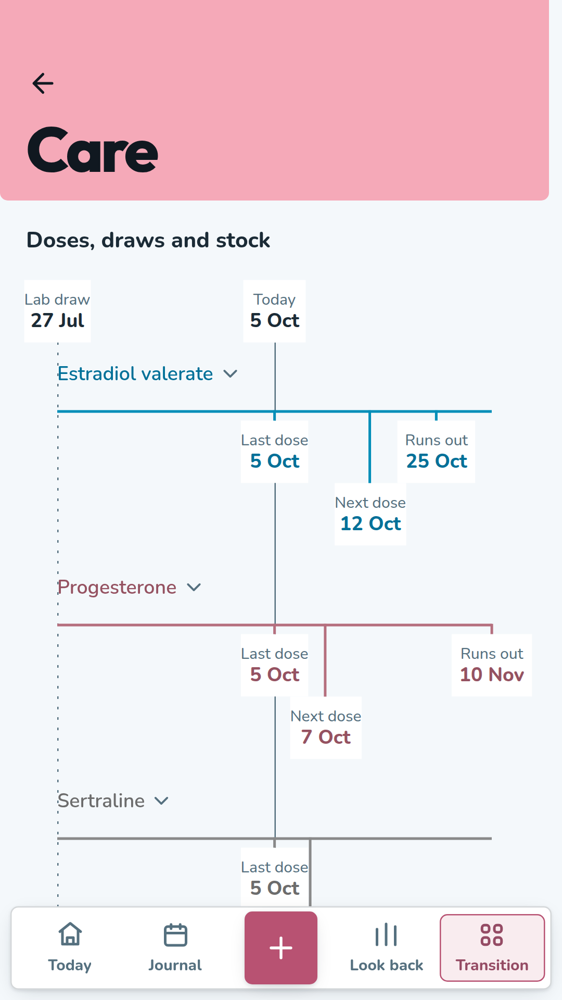

<h1>
  <picture>
    <source media="(prefers-color-scheme: dark)" srcset="brand/mark/png/lockup-dark.png">
    
  </picture>
</h1>

enGender is a private journal for exploring your gender or keeping a record of
your transition. A trans person built it for other trans people. You might jot
down how it felt when a barista called out your new name, mark the day on a
scale you named, then come back a month later to see how other days felt.

**[Open the web app](https://journal.engender.app/)** · [Read the getting-started guide](https://engender.app/en/guide/)

The journal is free, works in English and Polish, and needs no account.
You can install the web app from your browser and use it offline after the
first load. There is also an Android app.

<p>
  
  
  
</p>

## What you can keep

- **Daily entries.** A mood is enough. Add a note, photo or voice recording when you have more to say. Give each gender scale its own name and endpoints.
- **Things you try.** Save a voice practice recording to compare later, put two photos side by side, or mark a milestone on your timeline.
- **Care records.** Log doses, lab results and appointments. Choose what to include in a summary for a clinician.
- **Revisiting entries.** Find an entry by tag or on the calendar. Pick a month in **Look back** to see how your scales changed from day to day. You can also turn entries into a printable journal book.

You can import existing records from Daylio, Day One, TransTracks,
Track & Graph and Pixels.

## Privacy and backups

Your journal and its media stay encrypted on your device. The web app stores
them in this browser's storage for the site. The host counts page openings
without receiving your entries. The Android app has no internet permission.
You can lock the journal and use disguise mode for a neutral name and icon.
[Privacy policy in English](PRIVACY.md) · [Polityka prywatności](PRIVACY.pl.md)

**Before clearing app data or moving devices, export an encrypted Archive.**
Keep a copy somewhere other than the device and keep its backup password.
Restore the Archive to open your journal on another device. A recovery key
can unlock a journal still on your device. It cannot bring back a deleted
journal. CSV files, clinician summaries and journal books are readable by
anyone you share them with.

## Run from source

Use Node.js 24 and npm. Start the development server from the repository root.

```sh
npm ci
npm run dev
```

Open the local URL printed by Vite. The development server includes a demo
journal with sample entries, so you can try the screens with invented data.

For a production web build and the basic checks, run these in order. The
build generates files that the type checker and tests use.

```sh
npm run build
npm run check
npm test
```

To build a debug Android APK, install JDK 21 and the Android SDK, set
`ANDROID_HOME` to the SDK directory and sync the web build before running Gradle.

```sh
npm run build
npx cap sync android
cd android && ./gradlew assembleDebug
```

For the SvelteKit app, Capacitor shell and storage model, see the
[architecture guide](ARCHITECTURE.md). To run the web app on your own
domain, follow the [self-hosting guide](deploy/SELF-HOSTING.md).

## Help and contributions

Use invented entries when reporting a bug. [Get support](SUPPORT.md) ·
[Report a security issue privately](SECURITY.md) · [Contribute a change](CONTRIBUTING.md)

Licensed under [GPL-3.0-only](LICENSE).
